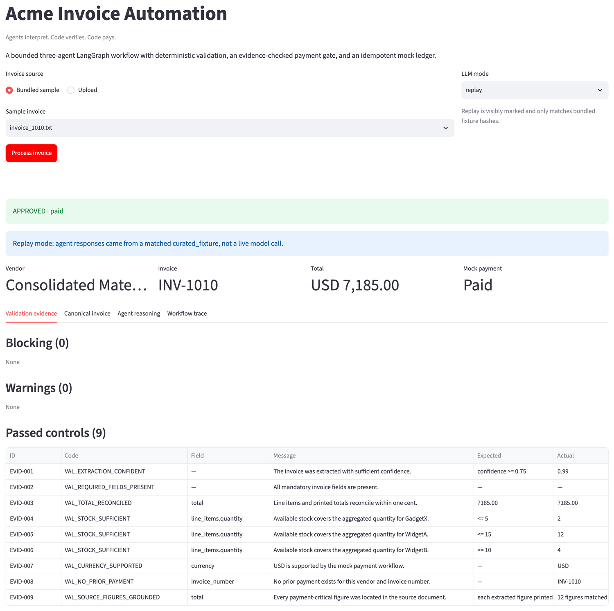
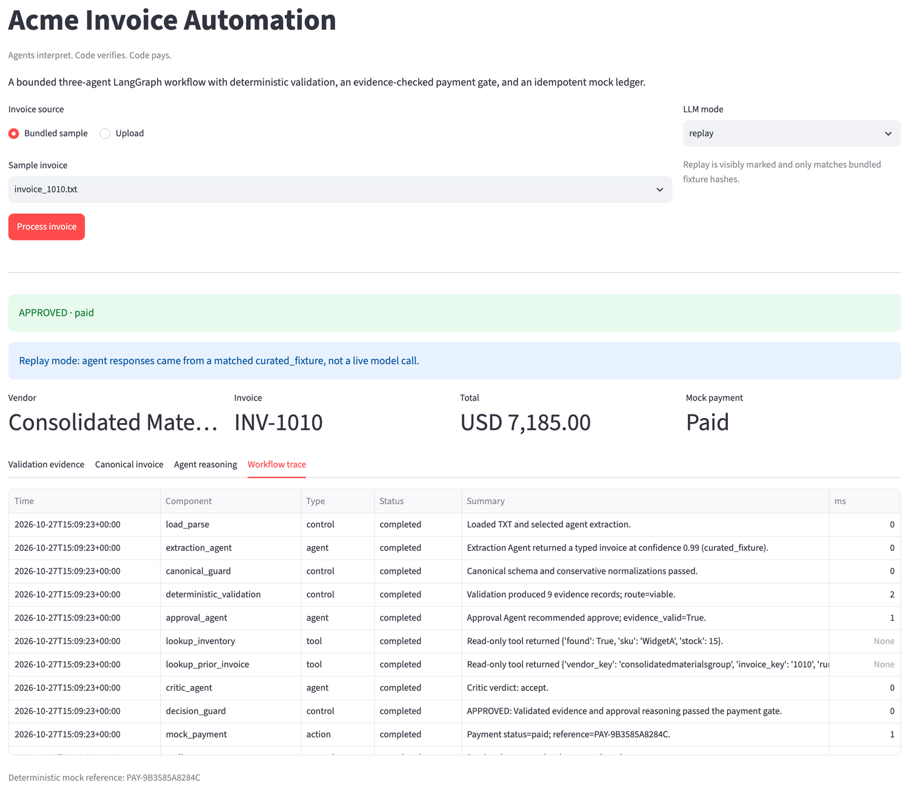

# Acme Invoice Automation

> **Agents interpret. Code verifies. Code pays.**

Three narrowly scoped LLM agents handle ambiguity and judgment; deterministic Python and SQLite
retain sole authority over financial truth and payment. The workflow accepts PDF, TXT, JSON, XML,
and two CSV layouts, produces an auditable `APPROVED` / `REJECTED` / `NEEDS_REVIEW` outcome, and
cannot pay the same business invoice twice.

## Five-minute reviewer path

Python 3.11+. No API key needed — bundled agent responses replay from curated fixtures.

```bash
python -m venv .venv && source .venv/bin/activate && pip install -e ".[dev]"

# 1. one invoice: full evidence and agent trace, paid on a fresh ledger
python main.py --invoice_path=data/invoices/invoice_1001.txt --llm-mode=replay

# 2. the whole corpus: 20 files collapse into 16 logical invoices;
#    the first invoice is recognized as already paid
python main.py --batch=data/invoices --out=results.jsonl --llm-mode=replay

# 3. 103 tests, lint
pytest && ruff check .

# 4. optional reviewer UI
streamlit run app.py
```

### The reviewer UI

`streamlit run app.py` opens a single screen: pick a bundled sample or upload a document, pick
an LLM mode, and process it. Replay is labelled on the result rather than passed off as
inference.



Every control is shown, passed as well as failed, with its expected and actual value — so an
approval is auditable rather than asserted.



The trace tab is the whole pipeline in order, including the two read-only tool calls the
Approval Agent made and the payment reference it produced.

### Three things worth looking at

**INV-1013 — repeated-SKU aggregation.** Eight line items reuse three SKUs. Checked line by line,
every one passes stock. Aggregated, all three blow out. Quantities are summed per canonical SKU
*before* inventory lookup, and the printed total is independently recomputed:

```
VAL_TOTAL_MISMATCH         expected=22512.80     actual=22562.80   <- $50 that nothing explains
VAL_INSUFFICIENT_STOCK     expected=<= 15        actual=22
VAL_INSUFFICIENT_STOCK     expected=<= 10        actual=18
VAL_INSUFFICIENT_STOCK     expected=<= 5         actual=9
```

**INV-1007 — arithmetic that almost works.** Line items sum correctly and the stated 6% tax is
correct, but the printed total is $110 short. Totals are never trusted, always recomputed:

```
VAL_TOTAL_MISMATCH         expected=15635.00     actual=15525.00
```

**Source-figure grounding — a hallucinated total cannot be paid.** Arithmetic proves an invoice is
*internally* consistent, not that it matches its document. A self-consistent fabrication used to
pass every control: a TXT source reading `$500.00` extracted as `$12,500.00` was paid in full. Now
every payment-critical figure must appear in the source document itself.

```bash
pytest tests/test_validation.py -k grounding -v
```

## Business impact

The challenge starts from a **$2M/year manual process, a 30% error rate, and a five-day approval
cycle**. A 20-file sample cannot support a production savings estimate, so this section claims
only what a run of the supplied corpus actually demonstrates: where automation removes manual
work, and where it should deliberately stop.

| Business problem | Design response | Evidence in the supplied corpus |
|---|---|---|
| Processing errors | Deterministic arithmetic, SKU aggregation, source grounding, and the payment gate keep financial facts out of LLM control | Catches INV-1007's **$110** total discrepancy and INV-1013's unexplained **$50**, plus aggregate stock breaches invisible line by line, negative quantities, zero-stock items, and unknown products |
| Five-day manual cycle | Clean invoices run extraction, validation, approval, critique, and payment without a human; ambiguous ones arrive pre-triaged with cited evidence | **5 of 16 logical invoices settle automatically**; the other 11 terminate as explicit rejection or review rather than entering an email approval chain |
| Cost and payment leakage | Structured extraction removes re-keying, while normalised identity and a transactional ledger prevent duplicate settlement | 20 files collapse to 16 logical invoices; rerunning the batch returns all five as `already_paid` and makes **zero** further `mock_payment` calls |

The 11 held invoices are the point as much as the 5 paid ones. Each carries the evidence that
stopped it, so a reviewer opens a decision rather than an investigation.

This is evidence of workflow behaviour, not an ROI estimate. Real figures would need a pilot
measuring labour per invoice, exception rates, and cycle time against the current process.

## Architecture


LangGraph is the orchestrator. Only three components are agents:

| Agent | Scope | Bound |
|---|---|---|
| **Extraction** | unstructured TXT/PDF text to the canonical schema | at most one targeted repair |
| **Approval** | reasons over validated evidence; may call read-only `lookup_inventory` and `lookup_prior_invoice` | cannot override blocking evidence; never receives a payment tool |
| **Critic** | independently challenges evidence support, missed findings, and policy consistency | runs after every approval; can withhold, never approve |

Parsing, normalization, validation, routing, the payment gate, and audit are deterministic
controls, not agents. A supervisor agent would add latency and another non-deterministic
decision-maker without improving a fixed workflow.

### Mapping to the brief

| Brief stage | Implementation | Agent? |
|---|---|---|
| 1. Ingestion | Extraction Agent for TXT/PDF; deterministic parsers for JSON/CSV/XML | yes |
| 2. Validation | `validation.py` — deterministic policy and evidence | no, by decision |
| 3. Approval | Approval Agent plus an independent Critic (the critique loop) | yes |
| 4. Payment | idempotent SQLite ledger behind the decision guard | no, by decision |

**Validation is deliberately not an agent.** The brief refers to a validation agent; this build
answers that stage with deterministic code, because validation here is arithmetic and set
reasoning — where a model is least reliable and this corpus is most adversarial. INV-1013's $50,
INV-1007's $110, and the aggregation breach above are all caught by recomputation and summation.
The inventory database stays agent-reachable as intended: the Approval Agent holds
`lookup_inventory` and `lookup_prior_invoice` as read-only tools, and the high-value gate requires
one lookup per canonical SKU. The schema matches the supplied starter exactly.

The supplied `mock_payment(vendor, amount)` is called, but only after the ledger commits. Payment
is one SQLite check-and-insert keyed on normalized vendor plus invoice number; the committed row
is the authoritative record, and `mock_bank.mock_payment` then stands in for the bank. A duplicate
returns before the insert and a failed insert raises, so neither can reach the bank. That keeps
the never-pay-twice guarantee, which the stub alone cannot express, without skipping the call.

Reasoning for both decisions: [docs/technical-notes.md](docs/technical-notes.md).

## Financial safety model

| Class | Examples | Route |
|---|---|---|
| Proven invalidity | nonpositive quantity, arithmetic corruption, known zero stock, clear stock overage | `REJECTED` |
| Unresolved uncertainty | unreadable extraction, ungrounded figure, unknown SKU, unsupported currency, paid duplicate, conflicting copies | `NEEDS_REVIEW` |
| Valid, with or without a soft warning | clean invoice, vendor alias claim, unusual terms, one pressure signal, high value | Approval and Critic |

`Decimal` arithmetic throughout, reconciled to one cent. Validation emits affirmative evidence as
well as problems, and approval must cite real evidence IDs — fabricated IDs are rejected by code.
Normalization is deliberately conservative: `Widget A` may become `WidgetA`, but `WidgetC` is
never fuzzily coerced onto a catalog item.

Invoices over USD 10,000 face a distinct enhanced-scrutiny gate: approval must cite the high-value
evidence, query prior history for the exact invoice identity, query inventory for every canonical
SKU, and obtain Critic acceptance. Missing any one routes to `NEEDS_REVIEW` even when the model
recommends approval. Payment itself is a single SQLite check-and-insert keyed on normalized vendor
plus invoice number, so the same business invoice cannot be paid twice across runs, formats, or
reruns — and an explicit revision marker such as `R1` can never be the first representation paid.

Rationale, evidence-code reference, ledger behavior, and live-run notes:
**[docs/technical-notes.md](docs/technical-notes.md)**.

## Supplied-fixture checkpoint

Outcomes arise from generic policy rules, never invoice-number branches. Amounts are the
canonical totals used by the payment gate.

| Invoice | Isolated outcome | Canonical amount | Fresh-batch behavior |
|---|---|---:|---|
| 1001 | `APPROVED` | USD 5,000.00 | paid |
| 1002 | `REJECTED` | USD 15,000.00 | insufficient stock |
| 1003 | `REJECTED` | USD 100,000.00 | known zero-stock item |
| 1004 | `APPROVED` | USD 1,890.00 | held with R1 as a conflict |
| 1004-R1 | `NEEDS_REVIEW` | USD 5,940.00 | explicit revision; held with original |
| 1005 | `REJECTED` | USD 15,225.00 | insufficient stock |
| 1006 | `APPROVED` | USD 2,750.00 | paid |
| 1007 | `REJECTED` | USD 15,525.00 | arithmetic and stock failures |
| 1008 | `NEEDS_REVIEW` | USD 9,900.00 | unknown SKUs |
| 1009 | `REJECTED` | USD -250.00 | missing fields, negative quantity, bad totals |
| 1010 | `APPROVED` | USD 7,185.00 | paid; includes USD 150.00 shipping |
| 1011 | `APPROVED` | USD 3,000.00 | equivalent PDF/TXT copies deduplicated |
| 1012 | `NEEDS_REVIEW` | USD 9,975.00 | unverified vendor alias; PDF/TXT deduplicated |
| 1013 | `REJECTED` | USD 22,562.80 | arithmetic and stock failures; copies deduplicated |
| 1014 | `NEEDS_REVIEW` | EUR 4,125.00 | unsupported currency |
| 1015 | `APPROVED` | USD 6,500.00 | paid; all three CSV item rows included |
| 1016 | `NEEDS_REVIEW` | USD 3,233.00 | unknown SKU |

The table assumes a fresh ledger. Following the five-minute reviewer path above, INV-1001 instead
appears as `already_paid` in the subsequent batch, because the single-invoice demo has already
settled it.

INV-1008 is deliberately `NEEDS_REVIEW` rather than `REJECTED`: both SKUs are absent from the
local catalog, which proves the system cannot verify them, not that the supplier's items are
invalid. Rejecting automatically would turn incomplete master data into a financial decision.

Repeating the full batch returns the same 16 results; paid items come back `already_paid` with no
second payment and no false collision.

## Live, replay, and auto modes

```bash
export XAI_API_KEY="..."
export LLM_MODEL="grok-4.7"
python main.py --invoice_path=data/invoices/invoice_1001.txt --llm-mode=live
```

| Mode | Behavior |
|---|---|
| `live` | Requires an API key and model; failures surface as infrastructure errors. |
| `replay` | Exact source-hash + agent + prompt-version match only. |
| `auto` | Live Grok when configured, otherwise a matching replay; unseen documents stop safely at `NEEDS_REVIEW`. |

> **Replay is never presented as live inference.** Bundled agent responses are hand-curated
> fixtures labeled `curated_fixture`, not captured model output, so reviewers can exercise PDF/TXT
> extraction, tool calls, and the critique loop without credentials. Replay therefore covers only
> bundled hashes: an unseen document still gets full deterministic parsing and validation, but
> needs live inference to complete an agent approval. A six-invoice live smoke test against
> `grok-4.7` on 2026-10-15 matched the table above — details and known gaps in
> [docs/technical-notes.md](docs/technical-notes.md).

## CLI contract

```bash
python main.py --invoice_path=PATH [--llm-mode=auto|live|replay]
python main.py --batch=DIRECTORY --out=results.jsonl [--llm-mode=...]
```

Single results are JSON on stdout; batch results are JSON Lines. A malformed batch member is
emitted as a structured error record while valid files continue processing, and the partial batch
exits nonzero. Business outcomes exit zero; configuration, file, database, and infrastructure
errors exit nonzero.

## Tests and layout

```text
main.py / app.py          CLI entry point; single-screen Streamlit reviewer UI
src/acme_invoice/
  graph.py                LangGraph nodes, routes, and bounded loops
  agents.py               agent contracts and the evidence verifier
  ingestion.py            PDF text extraction and deterministic parsers
  validation.py           deterministic policy, evidence, and source grounding
  db.py                   inventory, run history, and payment ledger
  llm.py / service.py     Grok, replay, fake clients; single and batch processing
  mock_bank.py            the supplied mock payment API, called after the ledger commits
tests/                    103 cases, run with Ruff in CI
```

Coverage includes every supplied file, both CSV layouts, targeted extraction repair, source
grounding against hallucinated totals, real tool execution, an Approval/Critic revision, prompt
injection, agent override attempts, paid reruns, cross-format collisions, repeated batches,
enhanced high-value scrutiny, and malformed XML/PDF isolation.

## Deliberate cuts

A local prototype, not a miniature accounts-payable platform. It intentionally omits a
supervisor/risk/payment agent, real banking, authentication, cloud deployment, a React or FastAPI
front end, durable human-review resume, provider abstractions, synthetic price catalogs, and
inventory decrementing — the assignment models invoice *payment*, not fulfillment.

Behavior was verified through the CLI, the automated test suite, a package build, and the rendered
UI. Beyond the six-invoice live check, no production-readiness claim is implied.
