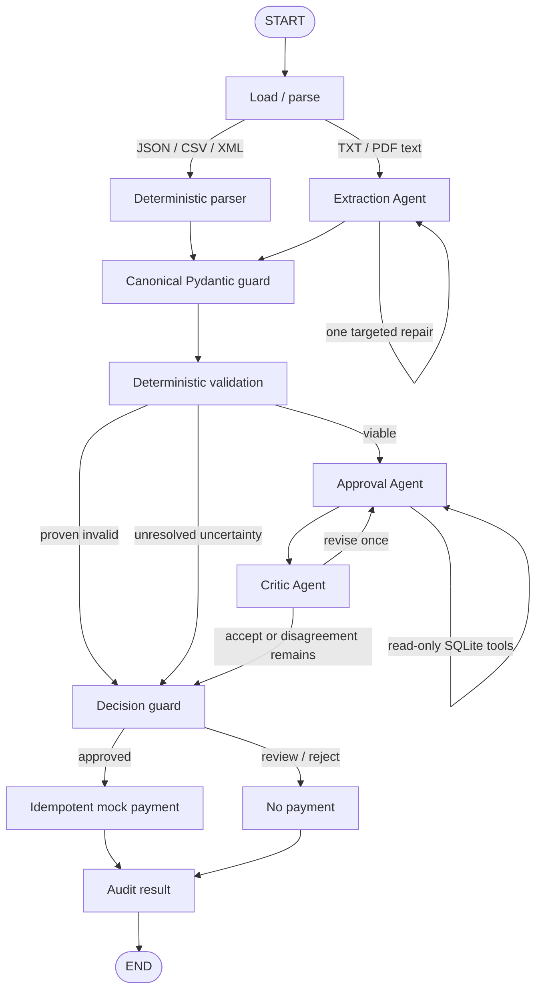

# Acme Invoice Automation

> **Agents interpret. Code verifies. Code pays.**

A LangGraph-based invoice-processing prototype in which three narrowly scoped LLM agents
handle ambiguity and judgment while deterministic Python and SQLite retain authority over
financial truth and mock payment.

The workflow accepts PDF, TXT, JSON, XML, and two CSV layouts; produces an auditable
`APPROVED`, `REJECTED`, or `NEEDS_REVIEW` outcome; and cannot pay the same business invoice
twice.

## Quick start

Python 3.11 or newer is required.

```bash
python -m venv .venv
source .venv/bin/activate
pip install -e ".[dev]"

# Keyless, transparent replay of a bundled fixture
python main.py --invoice_path=data/invoices/invoice_1001.txt --llm-mode=replay

# Process the entire supplied fixture directory as one collision-aware batch
python main.py --batch=data/invoices --out=results.jsonl --llm-mode=replay

# Reviewer UI
streamlit run app.py

# Verification
ruff check .
pytest
```

Inventory and ledger databases initialize automatically under the gitignored `.runtime/`
directory. Payments are mock ledger entries only; no banking integration exists.

## Architecture



LangGraph is the orchestrator. Only these components are agents:

1. **Extraction Agent** — converts unstructured TXT/PDF text to the canonical schema and
   receives at most one targeted repair request.
2. **Approval Agent** — reasons over validated evidence and may call the real read-only
   `lookup_inventory` and `lookup_prior_invoice` SQLite tools.
3. **Critic Agent** — independently challenges evidence support, missed findings, tool-backed
   claims, and policy consistency after every completed Approval Agent decision.

Parsing, normalization, validation, routing, the final decision gate, payment, and audit are
deterministic controls—not agents. A supervisor agent would add latency and another
non-deterministic decision-maker without improving this fixed workflow.

## Financial safety model

The system separates business findings into three classes:

| Class | Examples | Route |
|---|---|---|
| Proven invalidity | nonpositive quantity, arithmetic corruption, known zero stock, clear stock overage | `REJECTED` |
| Unresolved uncertainty | unreadable extraction, unknown SKU, unsupported currency, paid duplicate, conflicting copies | `NEEDS_REVIEW` |
| Valid with or without a soft warning | clean invoice, vendor alias claim, unusual terms, one pressure signal, high value | Approval and Critic |

Validation uses `Decimal` arithmetic and reconciles line amounts, subtotal, tax, freight, and
total within one cent. Repeated canonical SKUs are aggregated before inventory lookup.
Normalization is intentionally conservative: `Widget A` can become `WidgetA`; `WidgetC` is
never fuzzily coerced to another catalog item.

Validation emits affirmative evidence as well as problems, for example:

```text
EVID-003  VAL_TOTAL_RECONCILED   passed
EVID-004  VAL_STOCK_SUFFICIENT   passed   requested=10, available=15
EVID-006  VAL_CURRENCY_SUPPORTED passed   USD
EVID-007  VAL_NO_PRIOR_PAYMENT   passed
```

Approval must cite real evidence IDs. Code rejects fabricated IDs, prevents blocking evidence
from being ignored, and requires a clean approval to cite required fields, reconciled totals,
supported currency, sufficient stock, and no prior payment. Tool results appear in the trace,
but tool calls never replace mandatory validation.

Immediately before payment, the decision guard rechecks the validation route, approval,
evidence integrity, Critic acceptance, and prior-payment state. Every completed Approval Agent
decision is critiqued; the LLM never receives a payment tool.

SQLite performs payment check-and-insert in one transaction. The normalized vendor plus
invoice number is a unique idempotency key, and a deterministic `PAY-<hash>` reference makes
retries easy to audit. Inventory is not decremented because the assignment models invoice
payment, not fulfillment.

## Live, replay, and auto modes

Copy `.env.example` values into your environment when using live Grok:

```bash
export XAI_API_KEY="..."
export LLM_MODEL="grok-4.7"
export LLM_BASE_URL="https://api.x.ai/v1"  # optional; this is the default
python main.py --invoice_path=data/invoices/invoice_1001.txt --llm-mode=live
```

`XAI_API_KEY` takes precedence over `LLM_API_KEY`.

> **Live-validation status:** no xAI credential was available during implementation, so this
> repository has not yet been exercised against live Grok. The bundled agent responses are
> hand-curated fixtures—not captured model output—and are labeled `curated_fixture` throughout.
> Live Grok behavior, including structured-output and tool-call compliance, remains an explicit
> pre-production validation item.

| Mode | Behavior |
|---|---|
| `live` | Requires an API key and model before processing; failures are infrastructure errors. |
| `replay` | Uses only an exact source-hash + agent + prompt-version match. Bundled hand-curated fixtures are explicitly marked `curated_fixture`. |
| `auto` | Uses live Grok when configured, otherwise a matching replay; unseen LLM-dependent documents safely become `NEEDS_REVIEW`. |

Replay is never presented as live inference. It exists so reviewers can exercise PDF/TXT
extraction, tool calls, and critique loops without sharing credentials. Structured JSON, CSV,
and XML continue through deterministic parsing in every mode.

## CLI contract

```bash
python main.py --invoice_path=PATH [--llm-mode=auto|live|replay]
python main.py --batch=DIRECTORY --out=results.jsonl [--llm-mode=...]
```

Single results are JSON on stdout; batch results are JSON Lines. Operational messages and
errors go to stderr. Business outcomes exit successfully, while configuration, file, database,
and infrastructure errors return a nonzero exit code.

Exact paid sources return the existing result with `payment.status=already_paid`. Rejected or
reviewed sources are reprocessed and retain separate run histories. In batch mode,
semantically equivalent cross-format copies collapse before settlement; materially conflicting
copies of the same business identity are held for review.

## Supplied-fixture checkpoint

These isolated replay outcomes arise from generic policy rules, never invoice-number branches:

| Outcome | Supplied invoices |
|---|---|
| `APPROVED` | 1001, 1004, 1004-R1, 1006, 1010, 1011, 1015 |
| `REJECTED` | 1002, 1003, 1005, 1007, 1009, 1013 |
| `NEEDS_REVIEW` | 1008, 1014, 1016 |
| Agent-dependent warning | 1012 is held in the curated replay because its vendor-alias claim is not independently verified |

INV-1008 is deliberately `NEEDS_REVIEW`, not `REJECTED`: both SKUs are absent from the local
catalog, which proves that the system cannot verify them but does not prove that the supplier's
items are invalid. Automatically rejecting would turn potentially incomplete master data into a
financial decision. No fuzzy mapping is attempted.

The full batch produces 16 logical results from 20 files: equivalent 1011–1013 PDF/text/JSON
representations collapse, while the conflicting 1004 revision pair is held before payment.

## Tests and project layout

```text
main.py                         CLI entry point
app.py                          single-screen Streamlit reviewer UI
src/acme_invoice/
  graph.py                      LangGraph nodes, routes, and bounded loops
  agents.py                     the three agent contracts and evidence verifier
  ingestion.py                  PDF text extraction and deterministic parsers
  validation.py                 deterministic policy and evidence generation
  db.py                         inventory, run history, and payment ledger
  llm.py                        synchronous Grok, replay, and fake clients
  service.py                    single/batch processing and collision handling
data/replay/agent_responses.json transparent curated fixture responses
tests/                          ingestion, policy, agents, payment, pipeline, UI
```

The suite currently exercises 70+ cases, including every supplied file, both CSV layouts,
field-targeted extraction repair, positive evidence, actual tool execution, one Approval/Critic
revision, unresolved disagreement, prompt injection, agent override attempts, paid reruns,
cross-format collisions, replay transparency, CLI output, and a Streamlit smoke test. CI runs
Ruff and pytest on one Python version.

## Deliberate cuts and time spent

This is a local prototype, not a miniature accounts-payable platform. It intentionally omits a
supervisor/risk/payment agent, real banking, authentication, cloud deployment, React/FastAPI,
durable human-review resume, provider abstractions, synthetic price catalogs, and inventory
decrementing.

The elapsed work extended beyond the suggested window because it included architecture
research and iteration. OpenAI Codex was used as an AI coding assistant for implementation,
tests, and documentation; the behavior was then exercised through the CLI, automated tests,
package build, and rendered UI. The implemented scope remains deliberately constrained to the
reviewable MVP above; no larger production-readiness or live-Grok validation claim is implied.
